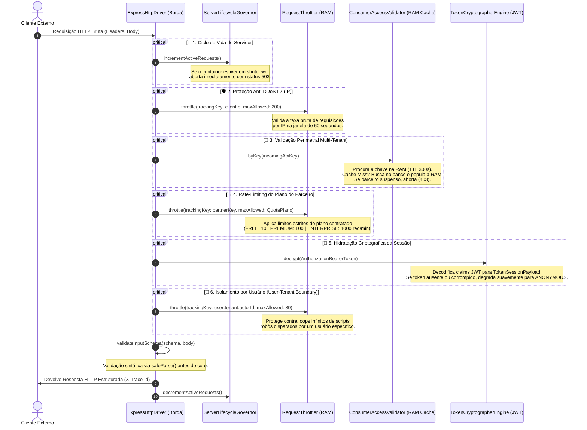

# TypeScript API Architecture Boilerplate — Agnóstico, Hexagonal & Camaleônico

Este projeto é um **esqueleto arquitetural plugável de alta maturidade** construído em JavaScript fortemente tipado via TypeScript. Ele foi projetado sob os preceitos rigorosos de isolamento de políticas e inversão de dependências (Clean Architecture / Ports & Adapters), operando com **acoplamento zero** em relação a frameworks web ou servidores de execução específicos.

A engenharia do ecossistema foca em entregar imunidade computacional contra alterações tecnológicas de borda, garantindo **portabilidade absoluta**, **observabilidade contextual estruturada**, **segurança perimetral multi-tenant** e **resiliência in-memory** com impacto zero de hardware. O Express e o Node.js presentes no repositório atuam estritamente como um **driver substituível** (um detalhe de infraestrutura), comprovando que o core das políticas centrais pode ser extraído e acoplado a qualquer outro runtime (como Next.js, Bun ou Cloudflare Workers) sem sofrer modificações.

---

## 🏛️ Racional Arquitetural: Princípio de Acoplamento Zero

A arquitetura do boilerplate rejeita de forma ativa a infiltração de dependências ou assinaturas de terceiros no núcleo do software. O ecossistema é inteiramente estruturado com base na **Inversão de Dependências (DIP)**: o domínio define os contratos puros de negócio; a infraestrutura periférica adapta-se a esses contratos através de barramentos de tradução de dialetos.

```text
[Cliente Externo] ──► [Borda Física: Express] ──► [Adaptador de Tradução] ──► [Contratos Puros: Engine]
                                                                                      │
                                                                                      ▼
                                                                             [Casos de Uso Soberanos]
```

### 🧬 Segregação de Fronteiras

* **Camada Soberana de Domínio (`src/api/`):** Opera imune a frameworks de rede. Ela trabalha exclusivamente com modelos, tipos e dicionários locais de tratamento centralizado de exceções (`DomainException`). Nenhuma classe ou função interna importa ou conhece assinaturas vindas de bibliotecas externas.
* **Camada de Contratos de Borda e Abstrações (`engine/`):** Localizada nas subpastas da infraestrutura, dita as regras e o formato com o qual os agentes de tecnologia externos devem interagir com a aplicação.
* **Camada de Periferias e Motores (`drivers/` ou `adapters/`):** Contém as implementações técnicas intercambiáveis. O dialeto compacto exigido por protocolos e SDKs externos (como o formato JWT ou o roteamento do Express) fica encapsulado aqui. É o único ponto autorizado a conhecer as dependências físicas da infraestrutura.

Essa separação garante o princípio **Open/Closed (OCP)** de Robert C. Martin: o ecossistema permanece fechado para modificações estruturais perigosas no core e totalmente aberto a extensões. Se a especificação de um transporte de rede mudar, altera-se apenas o arquivo de borda periférico, mantendo o restante do software imune a efeitos colaterais.


## 📂 Topografia do Ecossistema: Organização de Diretórios

A estrutura física do repositório reflete de forma ativa a separação entre políticas abstratas e mecanismos de detalhe. Abaixo está documentado o mapa real de arquivos presentes no projeto e suas respectivas fronteiras arquiteturais.

```text
src/
├── api/                             # CAMADA DE DOMÍNIO (Políticas de Negócio)
│   ├── errors/                      # Barramento Centralizado de Exceções Agnósticas
│   │   ├── domain/                  # Dicionários de Mensagens por Subdomínio
│   │   │   ├── accessIdentification.ts
│   │   │   ├── apiKey.ts
│   │   │   ├── home.ts
│   │   │   ├── identity.ts
│   │   │   ├── serviceResilience.ts
│   │   │   ├── throttler.ts
│   │   │   └── token.ts
│   │   ├── catalog.ts               # Verdade Única: ErrorCatalog e ErrorCode
│   │   └── domainException.ts       # Exceção de Domínio Soberana e Formatadores
│   ├── home/                        # Subdomínio de Testes Estruturais e Diagnóstico
│   │   ├── controller.ts
│   │   └── routes.ts
│   ├── identity/                    # Subdomínio de Acesso Progressivo
│   │   └── ports/                   # Casos de Uso Purificados e Isolados
│   │       ├── associateExternalIdentity.ts
│   │       └── registerAnonymousActor.ts
│   └── users/                       # Subdomínio de Entidades Locais
│       ├── controller.ts
│       ├── model.ts
│       └── routes.ts
├── config/                          # Parâmetros Globais Strongly-Typed
│   └── env.ts                       # Tipagem Estrita de Variáveis de Ambiente
├── database/                        # CAMADA DE DADOS SIMULADA (Mocks em RAM)
│   ├── apiKeys/
│   │   └── apiKeyTables.ts          # Linhas de Tabela e Chaves de Teste (Tenants)
│   └── mysql/
│       ├── instance.ts              # Conexões e Consultas Simuladas Linhas por Linha
│       └── tables.ts                # Mock de Registros de Usuários
├── infrastructure/                  # PERIFERIAS E ADAPTADORES (Mecanismos Técnicos)
│   ├── httpTraffic/                 # Tráfego de Rede e Validação Sintática
│   │   ├── adapters/
│   │   │   └── failureFormatter.ts  # Tradutor de Exceções de Domínio para Payload HTTP
│   │   ├── drivers/
│   │   │   └── expressHttpDriver.ts # Driver de Borda HTTP (Tecnologia Express)
│   │   └── engine/
│   │       ├── httpTraffic.ts       # Envelopes de Requisição e Resposta Agnósticos
│   │       └── httpValidation.ts    # Infraestrutura e Exceções de Validação de Borda
│   ├── identityProviders/           # Integrações de Autenticação Federativa Externa
│   │   ├── adapters/
│   │   │   ├── facebookAuthenticator.ts
│   │   │   ├── googleAuthenticator.ts
│   │   │   └── linkedinAuthenticator.ts
│   │   └── engine/
│   │       ├── federatedAuthenticator.ts # Contratos de Payload Federado
│   │       └── identityRepository.ts     # Abstrações de Consulta a Aplicações
│   ├── lifeCycle/
│   │   └── serverLifecycleGovernor.ts    # Controlador de Encerramento Seguro (Graceful Shutdown)
│   ├── resilience/
│   │   └── serviceResilienceGate.ts      # Mecanismo de Disjuntor Técnico (Circuit Breaker)
│   └── security/                    # Motores Perimetrais de Proteção Computacional
│       ├── apiKeyTenant/            # Read-Through Cache e Validação Administrativa
│       │   ├── adapter/
│       │   │   ├── accessValidator.ts
│       │   │   ├── databaseRepository.ts
│       │   │   ├── finder.ts
│       │   │   └── ramCache.ts
│       │   ├── drivers/
│       │   │   └── apiKeyInstance.ts
│       │   └── engine/
│       │       ├── cacheStore.ts
│       │       └── specification.ts # Contrato Perimetral Multi-Tenant de API Key
│       ├── throttler/
│       │   └── requestThrottler.ts  # Regulador Atômico de Janelas Slotted na RAM
│       └── token/                   # Hidratação e Descriptografia de Sessões JWT
│           ├── drivers/
│           │   └── expressJwtAdapter.ts
│           └── engine/
│               └── tokenSession.ts
├── apiRouter.ts                     # Orquestrador Agnóstico de Rotas Locais
└── server.ts                        # Composition Root e Bootstrap Geral do Ecossistema
```

---

## 🎯 Responsabilidades dos Componentes Centrais

Para evitar o espalhamento de responsabilidades cruzadas, cada componente cumpre um papel único e estritamente restrito à sua fronteira lógica:

### 1. Camada de Borda HTTP e Isolamento de Dialetos (`src/infrastructure/httpTraffic/`)
O framework Express e seus detalhes físicos de tráfego são inteiramente aprisionados dentro da classe `ExpressHttpDriver`. É responsabilidade exclusiva deste componente capturar cabeçalhos brutos, interceptar chamadas e converter dados fragmentados no envelope strongly-typed do sistema (`HttpTrafficRequest`). Isso garante que os controladores e as políticas de negócio nunca recebam parâmetros primitivos de rede como as assinaturas `req` ou `res`.

### 2. Motor de Perímetro Multi-Tenant e Cache RAM (`src/infrastructure/security/apiKeyTenant/`)
A governança e validação de acessos por parte de sistemas parceiros baseia-se na cooperação desacoplada de três sub-componentes:
*   **`DataBaseConsumerFinder`:** Funciona como a consulta de dados de infraestrutura, convertendo as linhas crúas e numéricas do banco (`ApiKeyRow`) no formato aceito pelo ecossistema.
*   **`ConsumerCacheStore`:** Aloca tabelas efêmeras em chips de memória RAM (`Map`) para reter as informações por 300 segundos, evitando queries físicas bombardeadas.
*   **`ConsumerAccessValidator`:** Orquestra a lógica de *Read-Through Cache*. Se houver um *Cache Hit*, valida o status do parceiro instantaneamente; se houver um *Cache Miss*, recorre à consulta ao repositório, popula a RAM e gerencia as exceções perimetrais de bloqueio administrativo (`API_KEY_SUSPENDED`).

### 3. Engenharia Centralizada de Erros (`src/api/errors/`)
O ecossistema adota uma postura de barramento de falhas de ponta a ponta. Em vez de entulhar os blocos do software com blocos `try/catch` tecnológicos, as políticas lançam a exceção soberana de negócio `DomainException` passando apenas chaves catalogadas do dicionário (`catalog.ts`). A falha viaja livremente até a portaria de rede, onde a classe `ApplicationFailureFormatter` intercepta o erro e realiza o mapeamento uniforme do status HTTP adequado (401, 403, 404, 422 ou 429).

## 🛡️ Blindagem Perimetral: O Pipeline Sequencial de Rede (A Jornada de um Clique)

O ecossistema implementa uma barreira de defesa em profundidade diretamente na portaria de tráfego HTTP. Essas barreiras operam de forma sequencial na memória RAM, garantindo imunidade computacional e proteção de recursos antes que qualquer parâmetro atinja as rotas internas da aplicação.

### 🛣️ Fluxo de Interceptação de Borda

Sempre que um cliente externo dispara uma requisição contra o motor web Express (`ExpressHttpDriver`), o ciclo de vida do tráfego percorre obrigatoriamente as seguintes travas atômicas:



---

### 🧠 Funcionamento das Engrenagens In-Memory

#### 📑 1. Regulador Dinâmico de Cliques (`RequestThrottler`)
Localizado em `src/infrastructure/security/throttler/requestThrottler.ts`, opera através do algoritmo de **Janela Fixa (*Fixed Window Rate Limiting*)**, recorrendo a estruturas efêmeras de `Map` alocadas diretamente nos chips de memória do processo Node.js. 

Quando o contador atômico associado a uma chave de rastreamento (`trackingKey`) supera o teto permitido dentro da janela ativa de 60 segundos, o barramento de segurança explode a exceção de domínio unificada do catálogo, interceptada com o status **`429 Too Many Requests` (REQUEST_THROTTLED)**. A requisição é abortada em microsegundos, poupando a CPU da aplicação de processar payloads maliciosos.

#### 🧠 2. Mecanismo de Cache Read-Through temporizado
Orquestrado pela classe `ConsumerAccessValidator` (`src/infrastructure/security/apiKeyTenant/adapter/accessValidator.ts`), o sistema implementa uma barreira de cache inteligente para chaves corporativas. Na primeira requisição do parceiro, ocorre um *Cache Miss* (falha de cache). O sistema recorre à persistência (`DataBaseConsumerFinder`), valida a credencial, monta um envelope temporal e grava uma cópia exata do registro na memória RAM com um tempo de expiração (*Time-To-Live*) de 5 minutos. 

Pelos próximos 300 segundos, todas as requisições leem exclusivamente essa cópia na RAM (*Cache Hit*), garantindo respostas em curtíssimo tempo e blindando as camadas de dados contra bombardeios aplicacionais. Se o registro indicar que o parceiro foi banido pelo painel administrativo, o motor dispara imediatamente a exceção **`403 Forbidden` (API_KEY_SUSPENDED)**.

#### 🧬 3. Hidratação e Degradação Suave de Passaportes de Identidade
O pipeline de segurança de perímetro isola a leitura de tokens JWT de forma resiliente. Caso o cabeçalho `Authorization` esteja ausente ou forneça um token com assinatura violada ou expirada, o motor web Express não quebra o fluxo com um erro fatal de runtime. 

Em vez disso, a portaria de rede realiza uma **Degradação Suave** do estado do cliente, instanciando um payload efêmero com o ator **`ANONYMOUS`** e metadados de borda purificados. Isso permite que o domínio processe a requisição de forma segura baseando-se em identificações progressivas ou assinaturas de hardware temporárias.

## 📊 Estratégia de Telemetria Estruturada: O Logger Camaleônico

O sistema rejeita o uso indiscriminado e destrutivo de comandos globais de console (como `console.log`), adotando uma abordagem fortemente tipada e contextualizada governada pelo contrato **`SystemLogger`** (`src/infrastructure/telemetry/engine/systemLogger.ts`). 

A implementação concreta **`SystemConsoleJsonDriver`** opera de forma adaptável com base nos parâmetros de inicialização gerados na Composition Root, alterando sua assinatura visual dinamicamente de acordo com o ambiente ativo:

1. **Comportamento em Produção (`Pretty Format: false`):** Emite strings lineares contínuas em formato JSON de linha única (*Single-Line JSON*). Este comportamento garante impacto computacional zero de hardware e fornece o padrão ideal para ingestão automatizada por coletores e agregadores de logs de mercado (como Splunk, Datadog, AWS CloudWatch ou ElasticSearch).
2. **Comportamento em Desenvolvimento (`Pretty Format: true`):** Realiza a indentação estruturada do JSON para torná-lo amigável ao olho humano e isola o rastreamento físico de erros (*Stack Traces*), renderizando as falhas em vermelho no terminal por meio de códigos de escape ANSI (`\x1b[31m`).

### 🧬 Rastreabilidade de Ponta a Ponta (Trace ID) e Contexto

No exato milissegundo em que uma requisição HTTP cruza a borda de entrada do driver, um identificador único universal (`crypto.randomUUID()`) denominado **Trace ID** é gerado. O driver Express invoca o método `.withContext()` para criar um envelope de telemetria isolado para aquele ciclo de vida específico:

```typescript
const uniqueTraceId = crypto.randomUUID();
const contextualLogger = this.systemLogger.withContext(uniqueTraceId, {
  clientIp: clientMetadata.ipAddress,
  userAgent: clientMetadata.userAgent,
  httpMethod: method.toUpperCase(),
  resourcePath
});
```

Todas as operações subsequentes acionadas dentro daquele fluxo herdam o mesmo Trace ID. O cabeçalho HTTP de resposta também é automaticamente hidrato com o campo **`X-Trace-Id`**, permitindo que clientes e equipes de SRE correlacionem uma falha na tela do usuário ao rastro exato de eventos na memória do servidor.

### 🛡️ Auditoria Corporativa de Não-Repúdio

Para separar logs de depuração operacional de registros de segurança críticos, o contrato disponibiliza a operação **`.audit()`**. Ela gera um log formatado de forma imutável sob a taxonomia `Security Audit Event: [action] executed by user [actorId]`, garantindo a retenção transparente de eventos de governança e tentativas de quebra de perímetro.

---

## 🛠️ Engenharia de Erros: O Barramento Centralizado de Exceções

O boilerplate implementa um modelo de **Tratamento Seguro de Erros por Inversão de Controle**. Em vez de poluir controladores locais e casos de uso com estruturas repetitivas de manipulação de respostas de rede, o núcleo do sistema limita-se a arremessar a exceção soberana de domínio **`DomainException`**, alimentada por chaves literais localizadas no catálogo unificado de erros:

```typescript
// Exemplo real de lançamento agnóstico na camada de negócios
throw new DomainException('SECURITY_TOKEN_CORRUPTED');
```

```text
 [ Camada de Negócio ] ──( Lança DomainException )──► [ Portaria HTTP (Express Driver) ]
                                                                 │
                                                                 ▼
 [ Cliente Externo (JSON) ] ◄──( Retorna Status Mapeado )── [ FailureFormatter ]
```

### 🎯 O Papel do Mapeador de Fronteira (`ApplicationFailureFormatter`)

A exceção viaja livremente pelo barramento computacional até ser capturada pela cláusula `catch` periférica do driver de rede. O driver delega a tradução de dialetos para a classe **`ApplicationFailureFormatter`** (`src/infrastructure/httpTraffic/adapters/failureFormatter.ts`), que executa o seguinte protocolo de formatação uniforme:

* **Exceções de Negócio (`DomainException`):** Captura a assinatura purificada do domínio, extrai o código corporativo (`uniqueCode`) e responde à rede com o status HTTP real de negócio previamente catalogado (ex: `401 Unauthorized`, `403 Forbidden`).
* **Erros de Validação Sintática (`ValidationException`):** Captura inconsistências de payloads barradas no portal de entrada (`safeParse`), mapeia o status uniforme **`422 Unprocessable Entity`** e anexa o array linear de violações de campos (`errors`) na resposta.
* **Erros Inesperados (`Error` bruto ou Falhas de Infraestrutura):** Ofusca mensagens nativas de banco de dados ou runtime para mitigar vazamentos de informações estruturais (*Information Disclosure*), mascarando a resposta sob o código genérico **`INTERNAL_SERVER_ERROR` (Status 500)**. Detalhes de depuração (`debugMessage`) são anexados opcionalmente apenas se o ambiente estiver configurado em desenvolvimento.

## 🔌 Resiliência Computacional: O Disjuntor Técnico (Circuit Breaker)

O boilerplate disponibiliza um mecanismo autónomo de proteção contra o efeito cascata catastrófico de lentidões ou quedas em APIs integradas de terceiros (como gateways de IA ou serviços de pagamento), encapsulado na classe **`ServiceResilienceGate`** (`src/infrastructure/resilience/serviceResilienceGate.ts`).

O componente opera de forma agnóstica diretamente na memória RAM, monitorando o histórico imediato de transações de rede para alternar entre três estados lógicos estritos:

*   **CLOSED 🟢 (Circuito Fechado):** Estado operacional padrão. O tráfego flui normalmente para as integrações. O portão monitora em silêncio.
*   **OPEN 🔴 (Circuito Aberto):** Se o serviço externo registrar **5 falhas consecutivas** (`failureThreshold`), o disjuntor desarma. Pelos próximos **60 segundos** (`cooldownPeriodMs`), qualquer nova chamada contra a integração é interceptada localmente na RAM e bloqueada em **0 milissegundos**, disparando imediatamente a exceção unificada **`EXTERNAL_SERVICE_UNAVAILABLE` (Status 503)**. Isso impede que requisições presas em timeouts longos entulhem a thread do servidor e esgotem a memória RAM do contêiner.
*   **HALF_OPEN 🟡 (Circuito Entreaberto):** Passados os 60 segundos de resguardo, o portão deixa passar uma única requisição de teste para avaliar a integridade da API externa. Se a chamada falhar, o circuito retorna para `OPEN` por mais um ciclo; se obtiver sucesso, restabelece o estado `CLOSED` automaticamente.

---

## 🧬 Controle de Ciclo de Vida do Servidor: Encerramento Seguro (Graceful Shutdown)

Para garantir o esvaziamento limpo de transações e proteger dados na RAM contra corrupção em ambientes de nuvem elástica (onde contêineres Docker são destruídos e recriados dinamicamente), o sistema delega a governança de processos à classe **`ServerLifecycleGovernor`** (`src/infrastructure/lifeCycle/serverLifecycleGovernor.ts`).

O driver de tráfego intercepta os sinais nativos de encerramento emitidos pelo sistema operacional Linux (**`SIGTERM`** e **`SIGINT`**) e orquestra a seguinte rotina de drenagem atômica in-memory:

```text
 [ Sinal SIGTERM / SIGINT Interceptado ]
                    │
                    ▼
 [ ServerLifecycleGovernor: isTerminating = true ] 
                    │
                    ├──► Rejeita novos cliques em 0ms com status 503 (SERVER_TERMINATING)
                    │
                    └──► Varre o contador na RAM: activeRequestsCounter
                                │
                                ├──► Se activeRequestsCounter == 0 ──► Força o Encerramento Imediato (process.exit(0))
                                │
                                └──► Se activeRequestsCounter > 0  ──► Inicia a Janela de Drenagem Segura (Timeout de 20s)
```

### 🧠 Mecânica dos Contadores Atômicos na RAM

*   **Entrada de Tráfego:** No início absoluto do processamento de qualquer endpoint, o `ExpressHttpDriver` invoca o método `.incrementActiveRequests()`, somando `+1` ao contador central. Se o servidor já estiver em estado de terminação, a entrada é barrada imediatamente.
*   **Saída Oblíqua Garantida:** Através do bloco **`finally`** do JavaScript na portaria de rede, o driver executa obrigatoriamente o método `.decrementActiveRequests()` tanto em cenários de sucesso quanto em capturas de erro, subtraindo `-1` do contador.
*   **A Salvaguarda Temporal (Hard Kill):** Se o contador zerar enquanto o sinal de encerramento estiver ativo, o processo é encerrado de forma limpa. Caso alguma operação de longa duração (como streaming de IA ou uploads) fique travada na memória, o governador ativa um timer imutável de **20 segundos** (`terminationTimeoutMs`). Se a janela de tolerância for violada, o sistema força um desligamento rígido (`process.exit(1)`) para resguardar a integridade da infraestrutura.


## ⚙️ Configuração, Instalação e Execução

As variáveis de faturamento computacional e parametrização do ecossistema são governadas de forma fortemente tipada pelo arquivo `src/config/env.ts`, que consome o manifesto local `.env`. 

### 📋 Pré-requisitos Mínimos

*   **Runtime Nativo (Opcional):** Node.js instalado (v18.0.0 ou superior).
*   **Ambiente Isolado (Recomendado):** Docker e Docker Compose instalados.

### 🔌 1. Inicialização Nativa Local

Para executar o ecossistema diretamente no hardware da máquina local através do interpretador assistido e otimizado em runtime, execute a sequência de comandos:

```bash
# 1. Instalar as dependências do manifesto de forma type-safe
npm install

# 2. Iniciar o motor em modo de desenvolvimento assistido (tsx watch)
npm run dev

# 3. Compilar o software via compilador TypeScript estrito (outDir: ./dist)
npm run build

# 4. Iniciar o servidor com a build compilada de produção
npm run start
```

*   **Comportamento do `npm run dev`:** Ativa o executor `tsx watch`. O motor monitora alterações em tempo de design nos arquivos e intercepta modificações no arquivo de variáveis `.env` em tempo real, reiniciando as instâncias na memória RAM sem derrubar o processo.

---

### 🐳 2. Inicialização via Docker Compose (Ambiente Isolado)

O repositório fornece suporte completo a contêineres Unix através do manifesto `docker-compose.yml`. O serviço é provisionado de forma não-privilegiada, mitigando riscos de segurança no ecossistema de infraestrutura.

Para subir a malha técnica e mapear os volumes bidirecionais locais dentro do contêiner, utilize os comandos oficiais:

```bash
# Subir o contêiner compilando as imagens na infraestrutura isolada
docker compose up --build

# Verificar o status de integridade e portas ativas do contêiner
docker compose ps

# Monitorar a emissão de logs camaleônicos em tempo real
docker compose logs -f

# Interromper a execução do ambiente de forma segura
docker compose down
```

#### 📊 Especificações Técnicas do Contêiner
*   **Imagem Base:** `node:24-alpine` (Garante pegada leve de hardware).
*   **Nome do Contêiner:** `nodeContainer`.
*   **Permissões de Execução:** `user: "node"` (Garante privilégios limitados).
*   **Rede Isolada:** `mentorjorel_nodeNetwork` (Driver bridge isolado).
*   **Portas Publicadas:** Redireciona a porta configurada no ambiente (`${PORT}`) para a porta interna padrão `3000`.

---

## 🔬 Testes, Validação e Qualidade de Código

A malha de validação estrutural apoia-se nas configurações estritas contidas no arquivo **`tsconfig.json`**, forçando o TypeScript a atuar como uma ferramenta ativa de análise estática e prevenção de falhas em tempo de compilação.

### 📐 O Rigor do Compilador Estrito (`tsconfig.json`)

O projeto está configurado com parâmetros de máxima maturidade arquitetural, obrigando o software a cumprir as seguintes regras:

*   **`strict: true`:** Ativa uma ampla gama de comportamentos de verificação de tipos, garantindo que inconsistências em assinaturas ou retornos não passem despercebidas.
*   **`exactOptionalPropertyTypes: true`:** Impede que propriedades opcionais de objetos sejam preenchidas com valores explicitamente nulos ou indefinidos de forma negligente, obrigando o cumprimento exato do contrato.
*   **`noUncheckedIndexedAccess: true`:** Força o desenvolvedor a validar a existência de chaves ou índices em dicionários e arrays antes de acessá-los diretamente, mitigando erros clássicos de runtime (*Cannot read property of undefined*).
*   **`verbatimModuleSyntax: true`:** Obriga o ecossistema a utilizar a sintaxe explícita de importação tipada (**`import type`**) para contratos consumidos apenas em tempo de design, eliminando códigos mortos na compilação final.
*   **`skipLibCheck: true`:** Ignora a checagem de tipos dentro de arquivos de declaração de bibliotecas de terceiros (`node_modules`), acelerando o tempo de build sem comprometer a integridade do seu core.

## 🚀 Como Evoluir e Estender o Boilerplate (Guia do Desenvolvedor)

A infraestrutura técnica deste ecossistema foi projetada sob o princípio de **Fácil Substituição de Detalhes**. Graças ao isolamento estrito imposto pelas fronteiras lógicas, o desenvolvedor pode plugar novas tecnologias ou substituir motores legados com impacto colateral zero no restante do software.

### 🔌 1. Como Substituir a Camada de Dados (Plugar um Banco de Dados Real)

Atualmente, o projeto utiliza uma persistência simulada na memória RAM localizada no diretório `src/database/`. Para migrar essa simulação para um banco de dados de produção (como PostgreSQL, MySQL ou MongoDB) sem tocar nos mecanismos perimetrais de rede ou na lógica de negócios, siga este protocolo de engenharia:

1. **Desenvolver o Novo Adaptador Concreto:** Dentro de `src/infrastructure/security/apiKeyTenant/adapter/`, crie uma nova classe (ex: `PostgresConsumerFinder.ts`) que implemente obrigatoriamente o contrato puro **`ConsumerFinderEngine`**:
   ```typescript
   import type { ConsumerFinderEngine }        from './finder';
   import type { ConsumerSpecificationEngine } from '../engine/specification';

   export class PostgresConsumerFinder implements ConsumerFinderEngine {
     public async byKey(identificationKey: string): Promise<ConsumerSpecificationEngine | null> {
       // 1. Executar a consulta física real utilizando o ORM/Driver de mercado
       // 2. Capturar o registro e traduzir as colunas crúas para o contrato da Borda
       return {
         identificationKey:        dbRecord.token_string,
         ownerDeveloperIdentifier: dbRecord.dev_id,
         rateLimitTier:            dbRecord.plan_tier,
         isAccessSuspended:        dbRecord.is_active === false
       };
     }
   }
   ```
2. **Plugar a Nova Instância na Composition Root (`src/server.ts`):** Vá ao ponto central de fiação do ecossistema, importe o novo adaptador e substitua a instância sem mexer em nenhuma linha do driver Express:
   ```typescript
   // Altere apenas a fiação física de infraestrutura
   // const databaseRepository = new DataBaseConsumerFinder(); // Antigo mock
   const databaseRepository = new PostgresConsumerFinder(postgresConnectionInstance);

   // O sistema de cache dinâmico e o Express continuam operando imunes à mudança
   const consumerAccessEngine = new ConsumerAccessValidator(databaseRepository, ramCacheStore, 300);
   ```

### 🧠 2. Como Criar um Novo Subdomínio de Negócio

Para adicionar novas capacidades de negócio sem violar os princípios de design de software, siga o fluxo estrutural:
* **Passo 1:** Crie uma nova pasta auto-contida dentro de `src/api/` (ex: `src/api/chat/`).
* **Passo 2:** Isole as assinaturas puras e contratos dentro de uma pasta local `ports/`, e as regras de execução em classes de casos de uso independentes (`useCases/`).
* **Passo 3:** Crie o controlador local (`controller.ts`) consumindo envelopes fortemente tipados e mapeie declarativamente o endpoint no arquivo `routes.ts` local.
* **Passo 4:** Plugue a nova rota no orquestrador unificado **`src/apiRouter.ts`**, expandindo o ecossistema sem alterar os componentes existentes.

---

## ⚠️ Limitações do Escopo Real

Antes de adotar o boilerplate para sistemas comerciais, os engenheiros de software devem estar cientes dos limites computacionais atuais da malha técnica entregue:

* **Involatilidade Volátil (Mocks na RAM):** Toda a camada de dados é simulada de forma efêmera na memória do processo por meio de arrays de teste (`mockApiKeyTable` e `mysqlUsersTable`). O reinício do contêiner Docker purga qualquer estado gravado ou alterado em tempo de execução.
* **Rate Limiting em Cenários Multi-Instância:** Como os dicionários do `RequestThrottler` e o cache do `ConsumerAccessValidator` operam em estruturas nativas de `Map` da memória RAM local, o boilerplate está limitado a rodar sob uma **Única Instância (Single-Pod)**. Caso a API seja escalada horizontalmente atrás de um Load Balancer sem uma camada distribuída de cache (como Redis), as contagens de cliques e janelas de Rate Limiting ficarão fragmentadas e dessincronizadas entre os nós.

---

## 📑 Mapeamento de Endpoints Operacionais

Com base nas rotas cadastradas ativas e nos controladores acoplados no arquivo unificado `src/apiRouter.ts`, a API disponibiliza em sua portaria as seguintes rotas factuais prontas para consumo:

* **`GET /` (Home):** Retorna o envelope de diagnóstico estruturado indicando o status operacional do motor técnico, identificando o ambiente de execução ativo (`development` ou `production`).
* **`GET /users/` (Users):** Lista a coleção de registros de usuários interceptada e traduzida a partir da tabela física mockada em memória.
* **`POST /users` (Users):** Executa a validação linear de campos (`name` e `email`), insere um novo registro de forma incremental no array RAM simulado e devolve a entidade purificada com o status `201 Created`.

---

## 🛡️ Mantenedor

* **Autor:** Luis Carlos da Silva Dias  
* **Contato Corporativo:** silvadias.perfil@outlook.com  
* **Repositório:** [GitHub Perfil](https://github.com)


